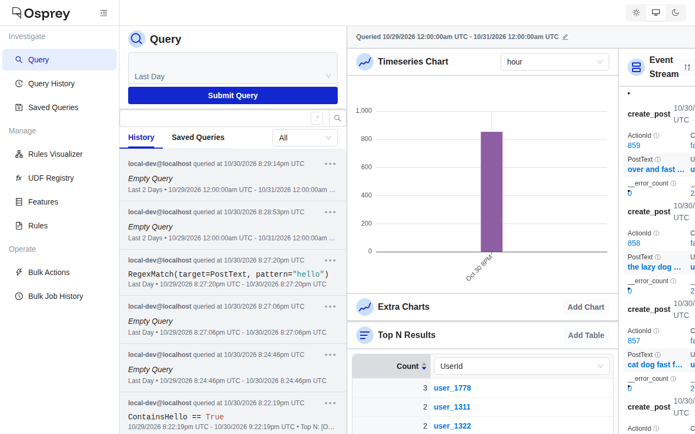
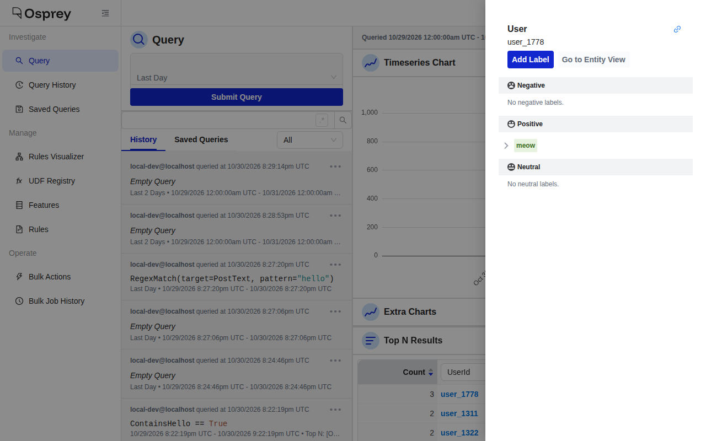

# Try Osprey in GitHub Codespaces

Run the Osprey demo in your web browser, with nothing to install. GitHub Codespaces gives you a temporary cloud machine running the whole Osprey stack, with synthetic demo data already flowing through it. You won't need to type any commands.

This is the same demo as [Getting Started](./), for people who'd rather not install Docker. Use it to look around the UI, show Osprey to someone, or check a UI change on a branch.

## What you need

- A GitHub account. Codespaces are billed to whoever creates them; see [Costs](#costs-and-time-limits).
- A recent desktop browser: Chrome, Edge, Firefox or Safari.

## 1. Open it

[](https://codespaces.new/roostorg/osprey?quickstart=1)

Click the button above (it's also on the [README](https://github.com/roostorg/osprey#readme)). On the next page:

- **Branch**: leave it on `main` for the latest version, or pick a branch to try someone's change.
- **Machine type**: keep **4-core**. The 2-core machine doesn't have enough memory for Osprey.
- Click **Create codespace**.

If you've opened one before, GitHub offers to **resume** it instead of making a new one. That's quicker, and keeps your earlier data.

## 2. Wait

A code editor opens in your browser tab. You can ignore the code. In the bottom half of the window, a terminal shows progress:

1. **Preparing**: the first time, the codespace downloads and builds Osprey's services. This takes about 10 minutes, or under a minute if the repository has a prebuild ready.
2. **Starting the Osprey demo**: each service comes up in turn, with a green ✓ beside it. This takes 1–3 minutes.
3. **Osprey is ready**: the terminal prints the address of the UI, and the Osprey UI opens in a new browser tab.

If the new tab doesn't appear (browsers sometimes block it), open the **Ports** tab next to the terminal, find **Osprey UI (5002)**, and click the globe icon.

## 3. Use it

The Query page opens empty. Click **Submit Query** to load the last day of events. (The terminal also prints a link that opens the page with this query already run.)



Synthetic posts arrive about once a second. The demo has one rule, `ContainsHello`: any post containing the word "hello" gets its author banned and labeled `meow`, so about a third of posts match.

- **Watch the event stream** on the right. Each card is one post, with what Osprey extracted from it; click **See Details** for the rule results and effects.
- **Filter with a query**: type `RegexMatch(target=PostText, pattern="hello")` in the query box and click **Submit Query** to see only the posts the rule matched.
- **Group with Top N**: the link the terminal prints adds a Top N table of `UserId`s, showing which synthetic users posted most. To add one yourself, click **Add Table** under Top N Results and pick a feature.
- **Look at a user**: click a user ID in the Top N table to open a panel with that user's labels. Users the rule banned are labeled `meow`.
- **Open the Rules Visualizer** from the left-hand menu, search for the `meow` label, and turn on **Show Upstream Nodes** to see the rule that applies it.



The [User Guide](../user/) covers the rest of the UI. The address of your UI tab is private to your GitHub account; sharing the link won't let anyone else in.

## 4. Stop it

A codespace stops by itself after a period without activity: 30 minutes, unless you've changed your [Codespaces settings](https://github.com/settings/codespaces). Only activity in the editor tab counts, so if you're presenting from the Osprey UI tab for a long time, click into the editor tab now and then, or raise the idle timeout in your settings.

To stop it yourself, go to [github.com/codespaces](https://github.com/codespaces), click **⋯** next to the codespace, and choose **Stop codespace**.

## 5. Come back

Open [github.com/codespaces](https://github.com/codespaces) and click the codespace's name. The demo starts again on its own, in a minute or two, and keeps the data from last time.

## 6. Delete it

When you're done with it, delete it so it stops using your storage: at [github.com/codespaces](https://github.com/codespaces), click **⋯** → **Delete**. GitHub also deletes codespaces that have been stopped for 30 days.

## Costs and time limits

Codespaces are billed to the person who creates them, unless an organization pays for its members' codespaces (ask your admin).

- **Personal GitHub accounts** include a free monthly allowance: at least 120 core-hours, which is 30 hours on the 4-core machine Osprey uses, and 15 GB of storage. Above that, the 4-core machine costs $0.36 an hour while running.
- A **stopped** codespace costs nothing per hour but counts towards storage until you delete it.
- Check what you've used at [github.com/settings/billing](https://github.com/settings/billing).

GitHub's [Codespaces billing page](https://docs.github.com/en/billing/managing-billing-for-your-products/managing-billing-for-github-codespaces/about-billing-for-github-codespaces) has current prices and limits.

## Troubleshooting

**The UI tab never opened.** Check the terminal: until it says **Osprey is ready**, the UI isn't up yet. Once it is, open the **Ports** tab and click the globe icon next to **Osprey UI (5002)**. If you see a GitHub sign-in page, sign in with the account that created the codespace.

**The UI loads, but the charts and event stream are empty.** Click **Submit Query**: the Query page doesn't run a query until you do. If it's still empty, Druid (the database behind the charts) may not have ingested events yet; it starts a minute or two after everything else. Wait a couple of minutes and submit again, and check the time range under the query box covers the last hour.

**The UI shows "Network Error" or red error messages.** A service may have stopped. Press **Ctrl+Shift+P** (**Cmd+Shift+P** on a Mac), type **Rebuild Container**, and choose **Codespaces: Rebuild Container**. This restarts the demo from scratch, deleting its data.

**"This codespace requires a machine with at least 4 cores and 16 GB of RAM"**, or no 4-core option. Your account or organization may limit machine types. Ask your organization admin, or create the codespace from a personal account.

**The terminal mentions "rate limit" or "toomanyrequests".** Docker Hub, where most of Osprey's services come from, limits how often one network address can download without signing in. Wait an hour and rebuild the container (as under "Network Error" above), or, if you have a Docker Hub account, add `DOCKERHUB_USERNAME` and `DOCKERHUB_TOKEN` (an [access token](https://docs.docker.com/security/for-developers/access-tokens/)) as [Codespaces secrets](https://github.com/settings/codespaces) for the `roostorg/osprey` repository, then rebuild.

**The terminal said "The Osprey demo didn't start cleanly".** Rebuild the container as above. If it happens again, run `docker compose ps -a` in the terminal and share the output with the Osprey maintainers in a [GitHub issue](https://github.com/roostorg/osprey/issues) or on [Discord](https://discord.gg/2brrzbqgJF).

**I closed the progress terminal.** Open a new one from the **☰** menu → **Terminal** → **New Terminal**, and run `bash .devcontainer/scripts/status.sh` to see whether the demo is ready.

## For engineers

The configuration lives in [`.devcontainer/`](https://github.com/roostorg/osprey/tree/main/.devcontainer): Docker-in-Docker on a 4-core / 16 GB machine, running `docker-compose.yaml` with the [`docker-compose.codespaces.yaml`](https://github.com/roostorg/osprey/blob/main/.devcontainer/docker-compose.codespaces.yaml) override. The override points the UI at the API through the UI dev server's `/api` proxy, so the browser only ever talks to the forwarded port 5002, and turns off the Druid web console. The same configuration works locally with any [devcontainer](https://containers.dev/)-capable tool, such as VS Code's Dev Containers extension or the devcontainer CLI:

```sh
npx @devcontainers/cli up --workspace-folder .
```

The container doesn't include the Python, uv or Node toolchains. For a full development environment, see [Local Development](local.md).

Running it locally on a host whose kernel lacks legacy iptables support (seen on Linux 7.0), Docker inside the container fails to start with `can't initialize iptables table 'nat'`. That comes from the Docker-in-Docker feature's choice of iptables backend on that host.
