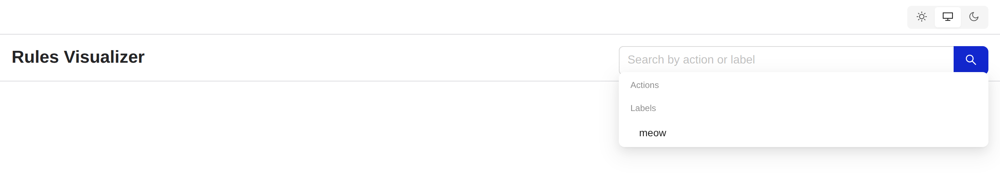
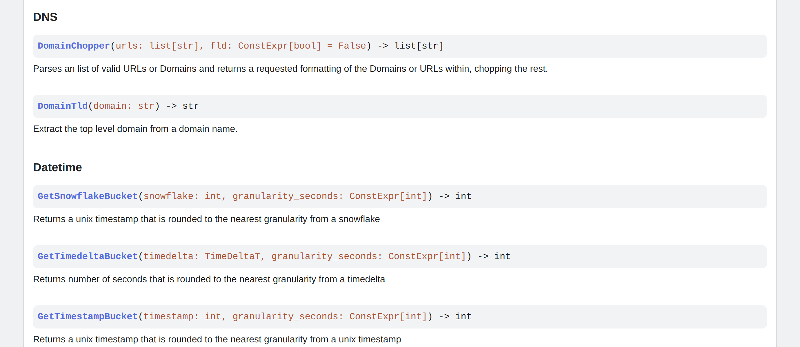

# Manage

The Manage section provides visibility into your Osprey configuration: the rules and features that power your detection, the functions available to query and rule authors, and tools to understand how everything connects.

## Rules Visualizer

The Rules Visualizer shows how rules and labels relate to one another in a dependency graph. It's useful for understanding what will fire when a particular label is applied, or what conditions must be true for a label to be produced.

To use it, search for an action or label in the search box. A graph appears showing the upstream and downstream relationships for your selection. You can toggle upstream and downstream visibility independently.

Node types in the graph:
- **Red ellipse**: a label that is upstream of a rule (an input condition)
- **Blue rectangle**: a rule
- **Green ellipse**: a label that is downstream of a rule (an output)

Hovering over a node shows its source file path. The graph supports zoom and pan to navigate large dependency trees.

## UDF Registry

The UDF Registry is an auto-generated API reference for every user-defined function (UDF) available in Osprey. It updates dynamically as UDFs are added or modified in code, so it always reflects what's actually available.

UDFs are organized by category and are searchable. Each entry shows:
- Function signature with syntax highlighting
- Description of what the function does
- Parameter names, types, and descriptions
- Return type

Use this page as your reference when writing rules, to confirm a function's exact name and parameter order. Note that most UDFs are for rules only: the query box supports just four functions (`RegexMatch`, `DidAddLabel`, `DidRemoveLabel`, `DidDeclareVerdict`), so using any other UDF in a query is rejected with an `unknown function` error under the query box.

## Features Registry

The Features Registry lists every feature defined in your Osprey deployment. Features are named variables extracted from events; they're what you query against and what rules operate on.

The list is paginated (50 per page) and can be filtered and sorted:

- **Search**: filter by name
- **Category filter**: narrow to one or more feature categories
- **Extraction function filter**: narrow to features using a specific extraction function
- **Unused only**: show only features nothing references
- **Sort**: by name, most referenced, or least referenced

Each row shows the feature's name, type, extraction function, source file, and how many rules, features, and WhenRules blocks reference it. Expand a row for its category, its full definition, and the rules and features that use it.

## Rules Registry

The Rules Registry lists every rule loaded in your Osprey deployment.

The list is paginated (50 per page) and can be filtered and sorted:

- **Search**: filter by name, source file, or description
- **Unused only**: show only rules that no `WhenRules` block uses, so they have no effects
- **Sort**: by name, most referenced, or least referenced

Each row shows the rule's name, source file, and how many `WhenRules` blocks use it. Expand a row for its description, its conditions, and the features it references.
